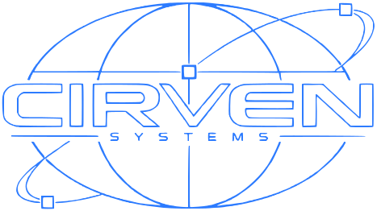

# cirven systems

Open-source defense modules for Linux developer workstations.
Website: <https://cirven.dev>

| module | does | status |
|---|---|---|
| `audit`  | find weaknesses, rank them by real attack paths | experimental |
| `harden` | fix findings: preview, apply, roll back | experimental |
| `watch`  | detect persistence: new units, autostarts, hooks | experimental |
| `lure`   | decoy credentials that alarm when touched | experimental |
| `pkg`    | inspect AUR and npm packages before install | experimental |
| `cage`   | sandbox tools and AI agents to what they need | experimental |
| `key`    | hardware key + password; unplug and it all locks | planned |

Each module is described in detail, threat model included, under `site/modules/`.

## Principles

- Local first, works offline, no account required, no telemetry.
- Every change is previewed and reversible.
- Every module ships a threat model: what it stops and what it does not.
- Least privilege, signed releases, reproducible builds.

## Roadmap

1. `audit` + `harden`: know and fix your own machine
2. `watch` + `lure`: notice when someone gets in
3. `pkg` + `cage`: stop it before it runs
4. `key`: tie it all to hardware

## License & business model

All code is Apache-2.0 and free. A paid, optional **cirven relay** may come later:
hosted alerting for `lure`, a signed package-intel feed for `pkg` and a fleet view
for teams. Self-hosting stays possible. Nothing is sold before it works.

## Install

Linux only. Requires Rust 1.85+.

```
cargo install --locked --git https://github.com/Artaeon/cirven cirven
```

## Use

```
cirven audit                         # read-only report, ranked by attack path
cirven harden                        # the fix plan; nothing changes
cirven harden --apply 1              # apply user steps; system steps need sudo
cirven harden --rollback <snapshot>  # undo a run byte for byte

cirven watch baseline                # record every persistence point
cirven watch                         # what changed since, and what it runs
cirven watch follow --notify         # keep checking, desktop alerts

cirven lure                          # where decoys would go; nothing changes
cirven lure plant                    # never overwrites existing files
cirven lure status                   # tripped by reads, changes, deletion
cirven lure watch --notify           # live, names the reading process

cirven pkg check aur/<name>          # also npm/<name>, or a local PKGBUILD
eval "$(cirven pkg wrap paru)"       # check every paru -S first

cirven cage -p agent -- claude       # project only, no ~/.ssh, ~/.aws, browsers
cirven cage --no-net -- makepkg      # no network at all
```

Each command has `--help`. State lives in `~/.local/state/cirven/` (or
`/var/lib/cirven/` as root).

## Safety

- `audit`, `watch`, `pkg` only read. A test snapshots a fixture system around
  an audit and fails on any changed byte.
- `harden` and `lure` show a plan by default and write only on request.
  harden snapshots before the first change and rolls back on any failure; lure
  never overwrites a file and removes only decoys whose hash still matches.
- Nothing restarts a service. Nothing is sent anywhere, except package
  metadata fetched from aur.archlinux.org or registry.npmjs.org on `pkg check`.

## Develop

```
cargo test        # unit tests plus end-to-end runs of the binary on fixture systems
cargo clippy --all-targets -- -D warnings
```

Every module reads the system through `cirven_core::Host`, which can point at
a fixture tree instead of `/`. The binaries accept a hidden `--root <dir>` for
the same purpose, which is how the end-to-end tests run.

## Repository layout

```
crates/cirven/          the `cirven` binary: one subcommand per module
crates/cirven-core/     shared types: module metadata, findings, severities, errors
crates/cirven-<module>/ one crate per module, design notes in its lib.rs
site/                   the website: static HTML + one CSS file, no JavaScript
brand/                  logo (PNG original, traced SVG) and wallpapers
```

Modules are separate crates so each keeps its own dependency tree and attack
surface: `cage` and `key` will need kernel and hardware interfaces that `audit` never should.

## Website

```
make serve   # preview on http://127.0.0.1:8000
make size    # bytes per page, raw and gzipped
make check   # fails on scripts, inline styles, event handlers, third-party URLs
```

Deploy `site/` to Cloudflare Pages (or Netlify). Both read `site/_headers`, which sets
a strict CSP, HSTS and the other security headers. GitHub Pages cannot set headers.
